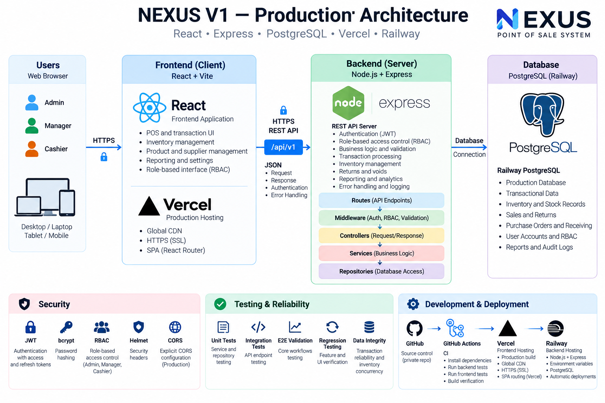
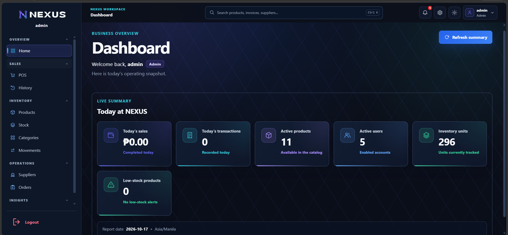
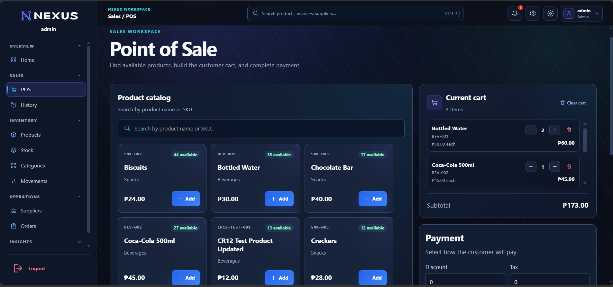
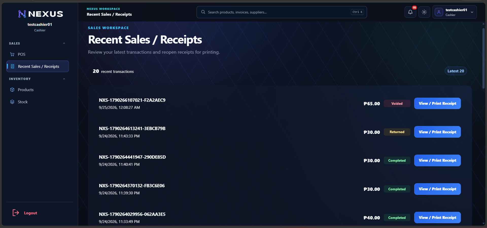
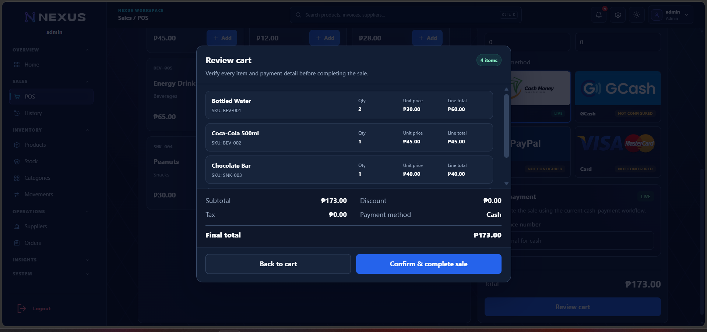
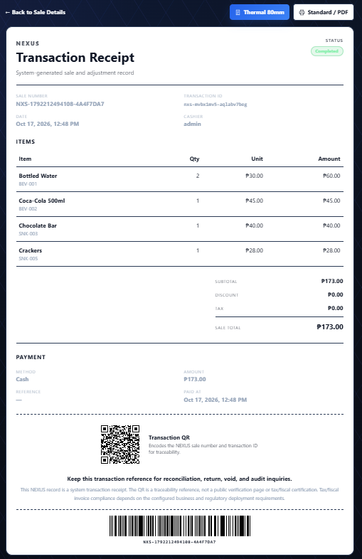

# NEXUS POS

**Production-deployed Point of Sale & Inventory Management System**

React | Vite | Node.js | Express | PostgreSQL | Vercel | Railway

**Production Deployed | CI Verified | PostgreSQL-backed**

This public repository presents the architecture, engineering approach, selected representative code samples, automated testing evidence, and product screenshots for NEXUS while the complete production source remains private and proprietary.

## Live Demo

**Coming soon.**

A controlled public demo will be added after demo access and production-safety restrictions are finalized.

## Overview

NEXUS supports core retail operations including:

- Point of Sale and checkout
- Product and category management
- Inventory and stock movements
- Suppliers and purchase orders
- Returns, voids, and refunds
- Sales history and reporting
- Role-based access control
- Notifications and settings
- Standard and thermal receipts with QR and Code 128 identifiers

## Architecture

The production architecture follows a layered full-stack design. React and Vite run on Vercel and communicate over HTTPS with a versioned `/api/v1` Express API running on Railway. Backend repositories access PostgreSQL through the database layer.

The backend separates routing, middleware, request handling, business logic, and persistence into distinct layers.

`Browser -> React/Vite -> HTTPS REST API -> Express -> Routes -> Middleware -> Controllers -> Services -> Repositories -> PostgreSQL`

Security controls include JWT authentication, bcrypt password hashing, role-based authorization, Helmet, environment-based configuration, and an explicit production CORS policy.

[Read the detailed architecture notes](docs/architecture.md)

## Technology Stack

### Frontend

- React
- Vite
- Axios
- React Router

### Backend

- Node.js
- Express
- PostgreSQL
- JWT authentication
- bcrypt
- Helmet
- CORS

### Infrastructure

- GitHub
- GitHub Actions
- Vercel
- Railway
- Railway PostgreSQL

## Application Roles

- **Admin** - administrative and system-management capabilities
- **Manager** - operational management capabilities
- **Cashier** - sales and authorized operational workflows

## Engineering Highlights

- Layered Route -> Controller -> Service -> Repository backend architecture
- Transaction reliability safeguards
- Inventory concurrency protection
- Role-based authentication and authorization
- Centralized frontend API and error handling
- Request tracing and structured observability
- Sensitive-value redaction in application logs
- Production health and readiness checks
- Automated CI verification
- Production deployment on Vercel and Railway

## Product Screenshots

### Dashboard

### Point of Sale

### Cashier Role — Recent Sales / Receipts

The cashier workspace exposes only the operational views required for sales, receipts, products, and stock access, demonstrating the role-based interface used in production.

### Review Cart

### Receipt

Additional product views are available in [`assets/screenshots/`](assets/screenshots/), including inventory, stock movements, sales history, Return/Void workflows, transaction records, and purchase orders.

## Selected Code Samples

The public repository contains a curated set of representative production-derived samples rather than the complete application source.

### Backend

- [`categoryRoutes.js`](code-samples/backend/categoryRoutes.js)
- [`categoryController.js`](code-samples/backend/categoryController.js)
- [`categoryService.js`](code-samples/backend/categoryService.js)
- [`categoryRepository.js`](code-samples/backend/categoryRepository.js)

Together these files demonstrate the Route -> Middleware -> Controller -> Service -> Repository layering used by the backend.

### Frontend

- [`apiClient.js`](code-samples/frontend/apiClient.js)
- [`getErrorMessage.js`](code-samples/frontend/getErrorMessage.js)
- [`PosProductCard.jsx`](code-samples/frontend/PosProductCard.jsx)

These samples demonstrate centralized API behavior, error normalization, retry safeguards, authentication handling, and React component design.

### Automated Testing

- [`observability.test.js`](code-samples/tests/observability.test.js)

The selected test sample demonstrates request tracing, request-ID validation, structured logging, secret redaction, query-string suppression, and error-handler contracts.

[Read the code-sample notes](docs/code-samples.md)

## Testing & Reliability

NEXUS has been verified through backend and frontend automated tests, regression testing, integration testing, authenticated end-to-end workflows, transaction reliability checks, concurrency testing, CI validation, and production smoke testing.

The public test sample intentionally excludes proprietary transaction, inventory-concurrency, Return/Void, reconciliation, and complete RBAC implementation details.

## Engineering Documentation

- [Architecture](docs/architecture.md)
- [Selected Code Samples](docs/code-samples.md)
- [Screenshot and Publication Safety Plan](docs/screenshot-plan.md)

## Source Code Boundary

The complete NEXUS production source repository remains private and proprietary.

The public showcase intentionally excludes the full database migrations, transaction and concurrency implementation, Return/Void internals, complete RBAC implementation, production configuration, and other proprietary implementation details.

For legitimate technical evaluation, deeper source review may be provided through temporary private repository access or a supervised code review.

## Ownership

Copyright © 2026 Aidrian A. Fernando. All Rights Reserved.
